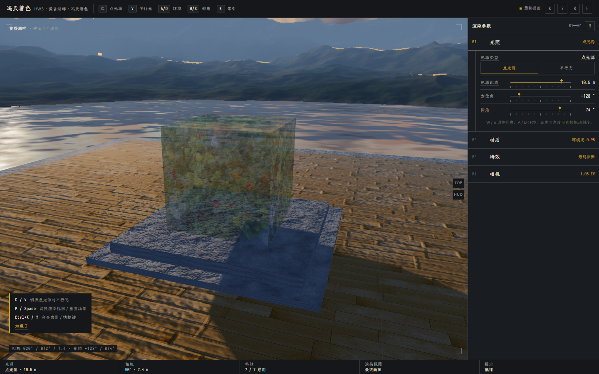

# HW3 · 光栅化场景渲染着色

黄昏湖畔场景：全屏 raymarch 地形（fBm 高度场、湖面、大气与体积云）、木地板与石材收边、黄铜镶嵌环、中央半透明花卉方块（可一键切成实体镜面）、点光源 / 平行光、阴影贴图、环境反射、凹凸、雾效与 3×3 PCF。



## 运行

页面通过同步 XHR 读取 shader，必须用 HTTP 打开，不能直接双击 `file://`：

```powershell
# 在工作区根目录
python -m http.server 8123
```

打开 <http://localhost:8123/实验/3/3/Phongshading.html>。需要支持 WebGL2 的浏览器；上下文不可用时页面会显示说明，而不是白屏。

## 操作

| 按键 | 动作 |
| --- | --- |
| `C` / `V` | 点光源 / 平行光 |
| `A` / `D` | 光源方位角 ∓5° |
| `W` / `S` | 光源仰角 ±2° |
| `Y` / `U` | 光源距离 ±0.5 m |
| `J` / `L` | 相机方位角 ∓5° |
| `I` / `K` | 相机仰角 ±2° |
| `M` / `N` | 视场角 ±2° |
| `P` | 切换渲染视图：最终画面 → 阴影 → 环境反射 → 雾效 → 法线 → 透明度 |
| `Space` | 重置场景参数 |
| `F` | 沉浸模式 |
| `Ctrl+K` / `/` | 命令索引 |
| `?` | 快捷键 |

鼠标：左键环绕，中键平移，右键或滚轮缩放。所有面板控件都可以直接拖动；命令索引里可以搜索并执行没有快捷键的动作。

## 参数面板

面板分四组，右侧栏对应 01–04；每组的值都能直接拖刻度。

| 分组 | 控件 | 作用 |
| --- | --- | --- |
| 01 光照 | 光源类型 / 距离 / 方位角 / 仰角 | 点光源用 90° 透视阴影相机，平行光用正交 ±12；阴影随光照实时重算 |
| 02 材质 | 环境光 / 漫反射 / 高光强度 / 高光锐度 | Blinn-Phong 三个分量与指数，直接对应 TODO2 |
| 03 特效 | 渲染视图 | 六个固定视图：最终画面 / 阴影 / 环境反射 / 雾效 / 法线 / 透明度 |
| 03 特效 · 正方体 | 环境反射、透明混合（两个开关并排） | 材质档位开关：透明混合开＝玻璃档（默认），关＝镜面档 |
| 03 特效 · 正方体 | 反射强度 / 不透明度 | 反射强度在镜面档是镜面占比、在玻璃档是环境高光强度；不透明度只控玻璃档的 alpha |
| 03 特效 · 地板 | 凹凸强度 / 凹凸贴图 | 只作用于木台与石材，同时作用于反射里命中的地板与台座 |
| 03 特效 · 环境 | 阴影、PCF 柔化、雾效、雾浓度、水面反射、水面反射开关、天空亮度 | 周围环境与大气 |
| 04 相机 | 视场角 / 距离 / 曝光 | 曝光在 ACES 之后统一施加，背景与物体不会出现色差 |

## 作业要求对照

基本要求（`HW3_todo/作业3要求.txt`）：

- 场景中设置光源与观察者，绘制多个几何体，光照色 / 纹理色 / 阴影色的计算主要在 fragment shader 里实现。
- **TODO1**：`configTexture.js` 的 `configureTexture()`——创建纹理对象、`REPEAT`、mipmap、各向异性过滤，并处理 `UNPACK_FLIP_Y_WEBGL`。
- **TODO2**：`shaders/box.frag` 的 `main()`——环境光、漫反射、Blinn-Phong 半程向量高光。
- **TODO3**：`shaders/box.frag` 的 `shadowCalculation()`——透视除法、深度比较、偏移，以及可开关的 3×3 PCF。

附加项（任选两个即可，本文档即说明）：

| 要求项 | 本作品的做法 |
| --- | --- |
| 立方体镜面用环境纹理 / 凹凸贴图 | 两个都做了：运行时捕捉的环境 cubemap + 木纹与石材的切线空间法线贴图 |
| 半透明 / 雾化 | 两个都做了：两层玻璃 + 指数平方雾 |
| 阴影反走样 / 其它特效 | 3×3 PCF；另有运行时环境捕捉、程序化地形、体积云 |

## 场景构成

- 木地板 `±9.6 m`、黄铜镶嵌环、石材收边 `±9.3 m`、两层台座，中央方块 `1.2 m` 锐边立方体。
- 光源默认点光源，距离 10.5 m、方位 −128°、仰角 74°；`C` / `V` 一键切平行光。
- 相机默认 `20° / 72° / 7.4 m`，视场角 50°；`-188° / 83° / 3.8 m` 是第二验收机位（进了回归矩阵）。

## 加分项实现

1. **环境反射**：运行时从主体中心把地形背景捕捉成 1024² 的 cubemap（6 面 + 线性 mip），方块与湖面共用这张贴图。镜面档下每个片元沿真实反射方向先与本地的两级台座、木地板、石缘、水面求交（一次求交，命中点自己按凹凸贴图算法线）——镜像里的地板同样有法线扰动、投影与雾效，湖面同样有 fbm 涟漪。本地都没命中才回退到环境贴图（山体 / 天空 / 云），按 LOD 0 取满分辨率，山脊不会糊成一片。
2. **凹凸**：木纹与程序化石材各生成一张 256×256 切线空间法线贴图：先做 5×5 均值模糊，再用 Sobel 求梯度，运行时绑定纹理单元 3。比屏幕空间 `dFdx` 更稳定，掠射角不会出现逐像素噪点；反射命中的地板也按反射光程取对应 mip，倒影里的纹路不会比实景更锐。
3. **半透明**：**透明混合**打开后进入玻璃档（默认就是这一档）——花体纹理是主体，环境反射只按菲涅耳叠一层加色高光，不替换颜色；先画背面（`CULL_FRONT`，压暗、alpha ×0.70）再画正面（`CULL_BACK`），`SRC_ALPHA / ONE_MINUS_SRC_ALPHA`、关闭深度写入，玻璃有体积而不是一层膜。“不透明度”滑杆只管玻璃档的 alpha，镜面档是实体，alpha 恒 1。地面与石材始终不透明。
4. **雾效**：指数平方雾 `1 - exp(-(density * dist)^2)`，物体与程序化地形共用同一雾色；反射多出来的那段“表面→命中点”光程按 `reflectFogScale = 0.35` 加权，否则镜面里的木地板会被雾洗得比旁边真地板更白；地形另有一套随距离增强的空气透视，保留远山层次。
5. **PCF**：3×3 阴影采样，可在“特效”分组关闭对比。

## 程序化地形

- 全屏四边形在片元着色器里用相机基向量重建射线：`forward + right * ndc.x * aspect * tanHalfFov + up * ndc.y * tanHalfFov`，不依赖逆矩阵。
- 高度场由四层值噪声 fBm 叠加两条脊状噪声构成：半径 28–44 抬升岸线，44–78 是主山脊，92–138 再叠一层远山，配合大尺度云影，避免一堵均匀的绿墙。
- 射线在高度场中步进（最多 80 步），落点用中心差分求法线；坡度、海拔与层理噪声决定草地、干草、岩石、沙岸的混合，并沿太阳方向再走一条 14 步阴影射线。
- 水面固定在 `y = -1.06`，用 fBm 梯度扰动法线；Fresnel 混合深水色与倒影，近岸按湖底深度混入浅水青绿，再叠太阳高光。
- 天空由地平线暖色、天顶蓝与太阳光晕组成；卷云按高空平面投影取样（早期版本直接按 `dir.xz` 取样，天顶方向噪声退化成常数，顶面是一整块蓝）。体积云在天空与山体之上单独合成（见下节）。输出前加 1/255 的抖动，消除大面积渐变的色带。主 Pass 与地形都做 ACES 近似，调曝光不会出现色差。
- 地形先画进 0.75 倍分辨率的 FBO，再以关闭深度测试的全屏四边形放大合成；平台、灯与立方体随后正常写深度。
- 所有渲染视图都绘制地形背景，`u_pass` 与 box 着色器共用同一套编号：阴影输出地形自阴影遮罩，环境反射让湖面显示倒影，雾效输出指数平方雾浓度，法线输出地形与水面法线，透明度统一给 1。切换视图时环境不再消失。
- 环境同步特效开关：关闭阴影时地形恢复满照度，关闭雾效时空气透视与末端雾一起收掉，关闭环境反射时湖面退回深水色；调试视图读取同一组开关。

## 体积云

- 云层是一块 `y = 35–140 m` 的水平平板，底边贴着远山脊线，顶边落在画面顶端的天空带；相机射线与 `CLOUD_BOTTOM / CLOUD_TOP` 求交得到板内区间，最多 40 步、带抖动地向前步进。
- 密度由三维值噪声 fBm 给出：先用一层二维 fBm 做域扭曲，再用三维 fBm 拉出云团主体，另加一层高频噪声收紧边缘；另有 285 m 尺度的大尺度噪声把云分成几团，团与团之间留出蓝天。
- 每步只在密度大于 0 时计算光照：朝太阳走 4 个递增距离的采样点累计光学厚度，得到云底暗、云顶亮的透光率，再乘高度衰减压暗底部；云色是冷灰蓝到暖白的混合，并叠加朝向太阳的银边。
- 透光率低于 0.97 才参与合成，避免低密度采样噪声落到山体上；云与山体的前后关系由地形步进返回的命中距离控制，山脊会正确遮住其后的云。
- 云层只保留 140 m 以外的部分，近处云团不会铺满画面顶端；`CLOUD_REACH = 700 m` 让远处云带在画面里保留完整云顶。

## 运行时环境贴图

- `render()` 里按“光照位置 + 地平光 + 雾浓度”生成签名，只有这些参数变化时才重建，相机移动不触发。拖动光照滑杆时签名逐帧变化，重捕会逐帧做六次 raymarch，所以留了 160 ms 的静默窗口：拖动期间继续用旧贴图，松手后由 `setTimeout` 补一次重建。
- 捕捉时把相机放在 `(0, cubeY, 0)`，六个面按标准 cubemap 朝向取 `forward / right / up`，`u_envMode = 1` 输出线性色并跳过 ACES；此时 `u_useEnv = 0`，水面退回解析天空，避免采样正在写入的立方体贴图。
- **每个面都要重新绑定地形 VAO**：上一轮循环的场景绘制会把 VAO 切到地板/台座的顶点缓冲，只在循环外绑一次的话，后五个面就是拿地板顶点去画全屏四边形，画面停在清屏色——整张立方体贴图退化成一块平色，镜面、湖面倒影一起变成“玻璃盖板”。实测证据是顶面所有像素都等于 `fogColor` 过一遍 ACES 的值，一个方向变化都没有。
- 捕捉过程会先把中央平台补进画面：向下的射线命中 `stoneHalf` 范围内的平台时，输出木板、黄铜环与石材收边，因此湖面和镜面的低角度倒影里能看到地板。
- 捕捉时放行近处云（`18–55 m` 起算），主视角永远俯视中央平台、看不到正上方天空，所以镜面顶面才有云与山脊可反射，而不是一整块纯蓝。
- 六个面画完后再 `generateMipmap`，湖面取 LOD 3.40 得到柔和倒影，镜面回退取 LOD 0 保住山脊细节。
- 捕捉时把“这个方向是不是陆地”写进立方体贴图的 alpha。镜面里的水面是按平面求交的，本地没有地形，不做这一步它会一路铺到地平线，看上去比旁边真湖面高出一截；命中水面后朝命中点方向查一次 alpha，已经是陆地就换成岸上颜色，湖面在真正的水岸处收住。

## 反射与透明的两档设计

同一个方块既要满足“半透明”又要满足“环境反射”，早期版本把两种身份塞进同一个 `u_opacity` 里，结果镜面被花体洗成一块内嵌面板、玻璃被镜面权重吃成一层幽灵。现在拆成两档，在着色器里真互斥：

| | 镜面档（透明混合关） | 玻璃档（透明混合开，默认） |
| --- | --- | --- |
| alpha | 恒 1，实体 | `u_opacity`，两层绘制 |
| 环境反射 | 反射就是表面本身：`mix(花体, 反射, 反射强度)` | 只叠菲涅耳加色高光，不替换花体 |
| 反射强度 | 镜面占表面的比例，0 就是 0 | 玻璃上的环境高光强度 |
| 不透明度 | 不参与（实体） | 控 alpha |
| 本地求交 | 需要，镜像里才有台阶与地板 | 不需要，跳过着色器里的求交 |

两档不共享调参变量，改一档不会动到另一档；矩阵里 `01-default`（玻璃）与 `02-mirror`（镜面）的差异只落在方块区域，可以直接验证这一点。

镜面档的着色对齐直接视图，这是“反射不像反射”的最后一关：

- 雾只算一次，且只按“多出来的那段光程”算：`surfaceDistance + bestT`，多出来的部分乘 `reflectFogScale = 0.35`，再不做第二次 `mix`。
- 反射命中点复用主分支的着色：高光按纹理亮度调制、凹凸 LOD 随反射光程、水面用同一套 fBm 涟漪法线。
- 掠射角下贴着地平线的反射方向不再被抬到 1.1°，否则会越过山脚直接采到山上方的天空，水天之间裂成一条亮边。
- 镜面里的水面不叠二次距离雾：指数平方雾在 70 m 就饱和，掠射角的水面动辄上百米，会把整条湖刷成一块灰带；环境贴图在捕捉时已经带过空气透视。

## 框架修正

模板中影响纹理、阴影、透明与反射的问题均已处理：

- `gl.readBuffer(gl.NONE)` 参数类型。
- 环境光 uniform 名称由 `ambientKaStrength` 改为 `ambientStrength`。
- 删除天空盒与六张 cubemap，背景改为程序化地形；反射改为运行时捕捉的环境 cubemap。
- 每个 program 独立 VAO，深度 Pass 不再依赖默认属性状态。
- `aspect` 取 drawingBuffer 宽高，去掉方形 letterbox。
- 光空间相机按 `lightPosition.w` 分支：点光 90° 透视，平行光正交 ±12。
- 深度贴图 2048。
- 地形背景使用独立 FBO，像素尺寸跟随 canvas 与 DPR 变化。
- 纹理单元固定：0 漫反射、1 深度、2 环境 cubemap、3 法线、4 地形背景、5 地面贴花、6 倒影木纹、7 地面法线（倒影凹凸用）。
- 环境立方体贴图的六个面逐面重绑地形 VAO（见上一节）：环内只绑一次会让五面停在清屏色。
- 方块几何改为锐边立方体，去掉圆角在轮廓上留下的 1 px 斜法线亮边；`u_opacity` 不再兼任反射占比，避免“调透明必然改坏镜面”。

另外，`ui-system/base.css` 补了两处共用修复：沉浸/收起时在 `utilities` 层覆盖顶栏 `display:flex`；收起顶栏或状态栏时把对应网格行的高度 token 置 0，窄屏布局不再留下空行。

## 颜色与后处理

- 主光 `vec3(1.00, 0.78, 0.54)`，环境光 `vec3(0.16, 0.22, 0.34)`，雾色 `vec3(0.34, 0.44, 0.58)`，地平线 `vec3(1.00, 0.55, 0.28)`。
- 主 Pass 与程序化地形都做曝光 + ACES 近似，避免调曝光时背景与物体出现色差。
- 木纹高光按亮度调制（暗纹 ×0.35），只有亮纹会反光。

## 性能取舍

- 环境捕捉停在 1024²：再往上（1536/2048）山脊更锐，但六面 raymarch 开销翻 2.25–4 倍，滑动光照滑杆时能感觉到卡顿；用 LOD 0 把现有分辨率吃满。
- 环境重捕有 160 ms 静默窗口，拖动光照滑杆期间继续用旧贴图。
- 镜像里的水纹用两八度噪声（地形那边是四八度）：方块近景能吃掉上百万像素，满配噪声直接把帧率拖下去，远看两者没差别。
- 玻璃档跳过本地求交，阴影 / 法线 / 雾 / 透明度四个调试通道在求交之前就返回。
- 地形步进与云层在写结果里必为 0 的分支上提前退出：半径 28 m 以内的湖底跳过三层山脊噪声，云区覆盖率为 0 时跳过整块三维噪声，步进区间整体落在 140 m 裁剪线以内时直接返回底色。三处都是逐位等价的改写，画面不变。
- 分辨率按实测帧间隔自适应：连续重绘时间隔超过 26 ms 且持续 6 帧就把绘制缓冲降到 0.55–1.0 倍（步长 0.1），连续 45 帧低于 19 ms 再逐档升回。检测到软件渲染（SwiftShader / Basic Render Driver / llvmpipe）时直接从 0.55 起步，环境贴图降到 512²。
- 剩下的主要开销是地形背景整帧 raymarch 与镜面命中点的 3×3 PCF，这两项都是作业要求的正片内容，没有再砍。

## 验证

- Chromium（Playwright，WebGL2）1440×900 与 900×900 两种布局，控制台 0 error / 0 warning，`gl.getError()` 为 0。
- 地形背景在 0.75 倍分辨率 FBO 生成，默认视角、俯视、窄屏与五种调试视图均无空白或接缝。
- DPR 2 下 drawingBuffer 为 CSS 尺寸的 2 倍，上限 2。
- 面板收起、沉浸模式、顶栏/状态栏收起、刷新后布局恢复、命令索引、快捷键、按键提示均已验证。
- `ui-system/scripts/check.ps1`：18 个文件通过；`node --check` 三个入口脚本通过。
- **视觉回归矩阵**（`tools/visual-guard.py`）：十个固定机位与参数组合（默认玻璃档 / 镜面档 / 反射关 / 雾关 / 低仰角 / 验收机位 / 环境反射 / 透明度 / 阴影 / 平行光）逐像素对比，改一项就能看出影响面。用法：

  ```powershell
  # 工作区根目录先起服务：python -m http.server 8123
  cd 实验\3\3
  python tools\visual-guard.py baseline          # 当前状态存为基线
  python tools\visual-guard.py check             # 出图并对比基线
  python tools\visual-guard.py check --update    # 认可后写回基线
  python tools\visual-guard.py shots             # 重出 screenshots/ 交付截图
  ```

## 文件

| 文件 | 作用 |
| --- | --- |
| `Phongshading.html` | 页面骨架与脚本顺序 |
| `Phongshading.js` | WebGL2 初始化、VAO、FBO、光空间矩阵、阴影 Pass、环境捕捉、主 Pass、鼠标交互 |
| `Models.js` | 立方体、地面与屏幕四边形几何，返回独立数组，便于逐程序建 VAO |
| `configTexture.js` | TODO1；木纹 / 石材纹理、运行时法线贴图、地面镶嵌贴花 |
| `configMaterialParameters.js` | 材质默认值、颜色、uniform 上传 |
| `commands.js` | 命令注册表：所有键盘动作与面板动作的唯一入口 |
| `ui.js` | 参数面板 schema、上下文提示、状态栏、首次引导 |
| `scene-utils.js` | 角度、取整、钳制等场景层小工具 |
| `shaders/box.*` | 主 Pass（TODO2 / TODO3），镜面档与玻璃档两个互斥分支 |
| `shaders/depth.*` | 阴影 Pass |
| `shaders/terrain.*` | 全屏光线步进地形、水面、程序化天空与体积云 |
| `shaders/composite.*` | 0.75 倍分辨率地形背景放大合成 |
| `shaders/decal.*` | 黄铜镶嵌环贴花 |
| `tools/visual-guard.py` | 视觉回归矩阵：十个固定机位出图、逐像素对比、重出交付截图 |
| `tools/matrix.json` | 回归矩阵的机位与参数 |
| `tools/shots.json` | 交付截图的机位与参数 |
| `HW3-报告.docx` | 实验报告 |
| `screenshots/` | 交付截图，编号与下文对应 |

## 截图

| 编号 | 内容 |
| --- | --- |
| `01-default.png` | 默认视角（玻璃档） |
| `02-first-run.png` | 首次进入的三行引导 |
| `03-pass-shadow.png` | 阴影通道 |
| `04-pass-reflect.png` | 环境反射通道：方块显示它反射到的场景，地板与台阶显示各自反射到的天空 |
| `05-pass-fog.png` | 雾效视图 |
| `06-pass-normal.png` | 法线通道 |
| `07-pass-alpha.png` | 透明度通道 |
| `08-directional.png` | 平行光 |
| `09-bump-on.png` / `10-bump-off.png` | 凹凸开关对比（高光调低、光源抬高，便于观察） |
| `11-fog-off.png` | 关闭雾效 |
| `12-reflect-off.png` | 关闭环境反射 |
| `13-mirror.png` | 透明混合关 · 镜面档 |
| `14-shadow-off.png` | 关闭阴影 |
| `15-pcf-off.png` / `16-pcf-on.png` | PCF 对比 |
| `17-rack-collapsed.png` | 参数面板收起为侧边栏 |
| `18-immersive.png` | 沉浸模式 |
| `19-command-index.png` | 命令索引 |
| `20-key-ledger.png` | 快捷键 |
| `21-effects-panel.png` | 特效分组展开 |
| `22-narrow.png` | 900 px 窄屏 |

## 已知边界

- 玻璃档的花体整体偏暗：两层面片叠加后压了一档，`不透明度` 拉到 0.6 以上会亮一些，默认 0.45 偏含蓄。
- 镜面里的湖面用环境贴图的 alpha 判断水岸，是按方向近似而不是逐像素地形求交，所以岸线比实景糊、细节少；做真遮挡得把地形高度场搬进 `box.frag` 或给环境贴图补深度。
- 环境 cubemap 从方块中心捕捉、方块自己不进捕捉，所以湖面倒影里没有方块。
- 镜面只反弹一次：反射里不会再有反射。